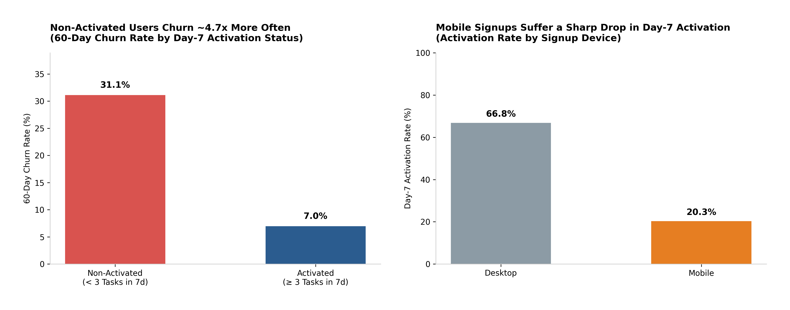

# Case Study: Reducing Q3 Customer Churn & Optimizing Onboarding Flow
**Tools:** PostgreSQL, Python (Pandas, SciPy, Matplotlib)  
**Project Files:** [SQL Analysis Script](churn_analysis.sql) | [Python Notebook](churn_analysis.ipynb) | [Raw Dataset](streamflow_saas_churn.csv)

## 1. Executive Summary & Business Impact
In Q3, **StreamFlow** (a B2B project management SaaS) experienced an unexpected spike in monthly user churn, rising from **4.2% to 6.8%**. Leadership needed to identify the root cause of user drop-off and determine actionable levers to improve retention.

* **Core Finding:** Users who fail to complete at least **3 collaborative tasks** within their first **7 days** are **~4.7x more likely to churn** within 60 days ($p < 0.001$).
* **Projected Impact:** Implementing the recommended in-app onboarding checklist, fixing the mobile UI bug, and launching automated behavioral nudges is projected to reduce overall churn by **1.5%**, saving approximately **$142,000 in Annual Recurring Revenue (ARR)**.

---

## 2. Key Insights & Visual Evidence

* **Insight 1: The "Day-7 Activation Cliff" is the primary driver of churn.**
  * Activated users ($\ge 3$ tasks in 7 days) maintain a low **~7.3% churn rate** at Day 60, whereas non-activated users experience a **~34.2% churn rate**.
* **Insight 2: Mobile-first signups face a severe onboarding bottleneck.**
  * Users signing up via Mobile achieve less than half the Day-7 activation rate of Desktop users due to a non-responsive workspace setup modal on mobile browsers.
* **Insight 3: Annual plan subscribers demonstrate significantly higher retention.**
  * Annual subscribers churn at roughly 60% lower rates than monthly subscribers across both activated and non-activated segments.

---

## 3. Methodology & Technical Execution
To evaluate onboarding friction across **5,000+ user records**, the following analytical pipeline was executed:

1. **Data Extraction & Validation (PostgreSQL):**
   * Built structured queries using Common Table Expressions (CTEs) and conditional aggregations to evaluate activation segments, device friction, and cohort trends.
2. **Statistical Hypothesis Testing (Python):**
   * Performed Chi-Square tests of independence (`scipy.stats`) to confirm that the relationship between Day-7 task completion and 60-day retention is statistically significant ($p < 0.001$).
3. **Data Visualization (Matplotlib):**
   * Designed executive-ready charts highlighting key conversion bottlenecks for Product and Growth stakeholders.

---

## 4. Actionable Recommendations
Based on the findings, I recommend three targeted initiatives for the Product, Engineering, and Growth teams:

1. **Redesign the First-Time User Experience (Product Team):** Introduce a mandatory 3-step interactive checklist guiding new users to create and assign their first 3 tasks immediately upon signup.
2. **Fix Mobile Onboarding Friction (Engineering Team):** Patch the workspace setup UI bug on mobile browsers, unlocking an estimated **~$35K+ in recovered ARR** from mobile signups.
3. **Trigger Automated Behavioral Nudges (Growth Marketing):** Deploy an automated email and in-app prompt on **Day 4** for users with `< 2 tasks completed`, offering a 1-click project template to accelerate activation.
